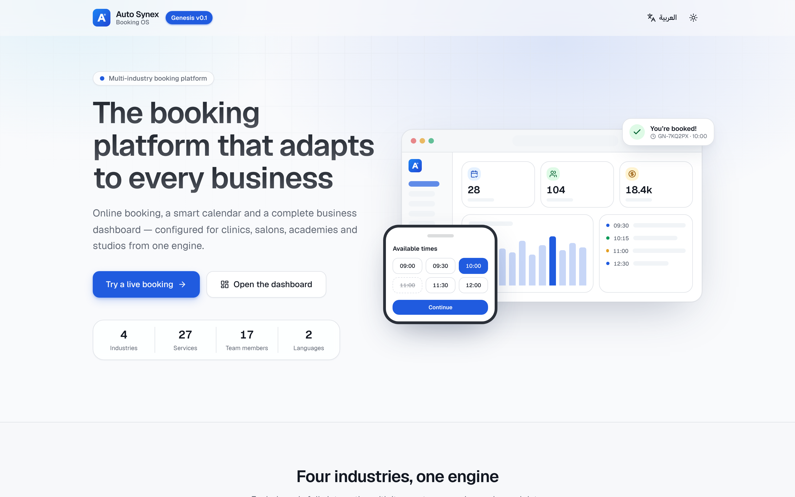
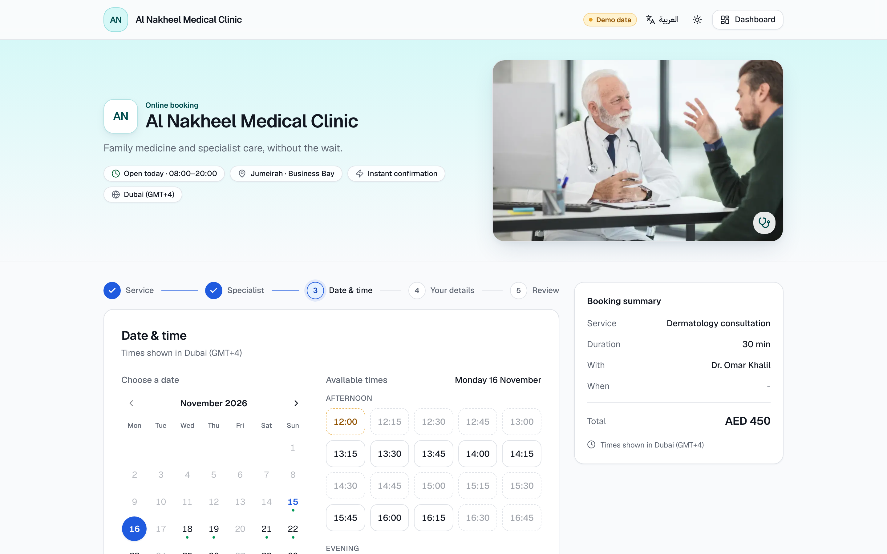
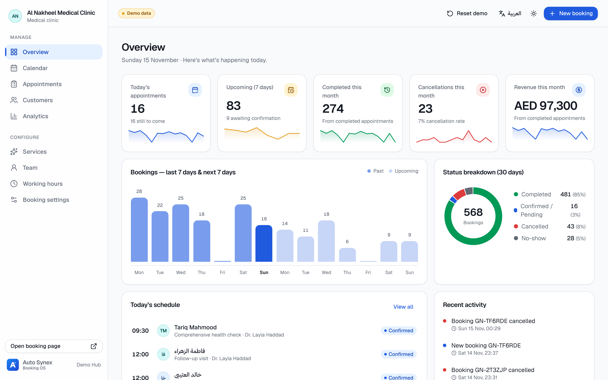
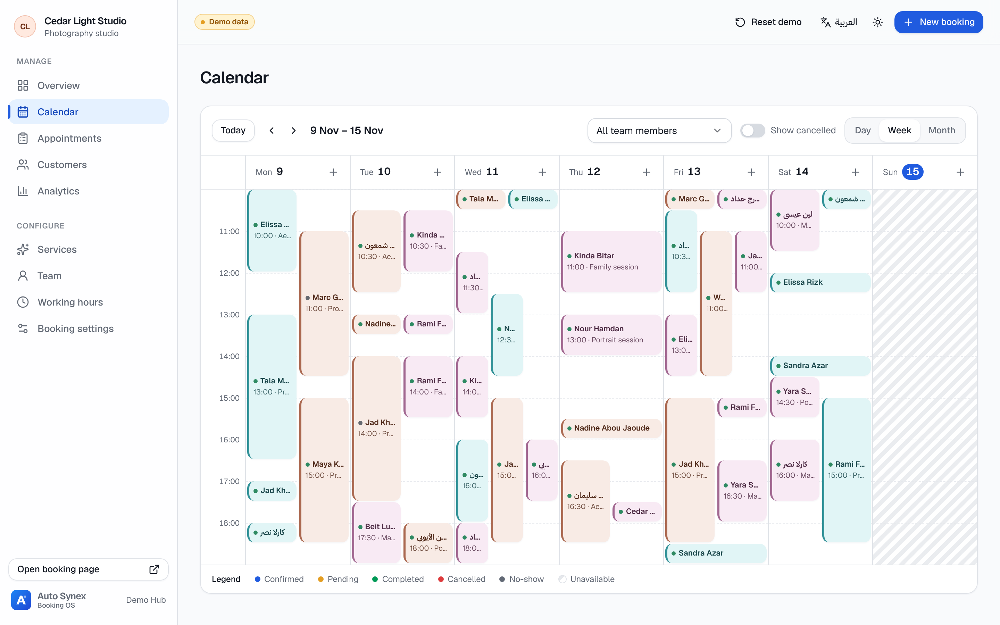
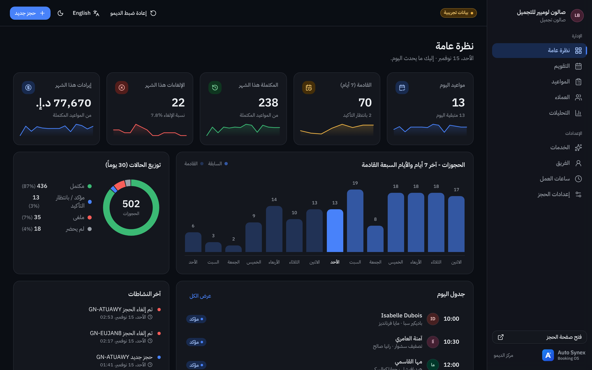

# Auto Synex Booking OS — Genesis demo v0.1

An interactive, multi-industry booking SaaS demo. One booking engine is configured
four ways (medical clinic, beauty salon, training academy, photography studio). Each
industry has its own business profile, services, team, booking rules, appointments,
public booking portal and business dashboard.

> **All data is demo data.** It is generated on first visit and stored in the
> browser's `localStorage`, separately for each industry. Use **Reset demo** at any
> time. Conflict checks run in the browser only, so they are **not multi-user safe**
> (see [docs/ARCHITECTURE.md](docs/ARCHITECTURE.md)).

## Screenshots

| | |
| --- | --- |
|  |  |
|  |  |
|  |  |

## Quick start

```bash
cd genesis
npm install
npm run dev            # http://localhost:3000
```

| Command | What it does |
| --- | --- |
| `npm run dev` | Development server |
| `npm run build` / `npm start` | Production build / serve it |
| `npm run typecheck` | Generates Next route types, then `tsc --noEmit` |
| `npm run lint` | ESLint (Next core-web-vitals + TypeScript rules) |
| `npm test` | Vitest — booking rules, time zones, demo repository |
| `npm run check` | All of the above in sequence |

Requires Node 20+ (developed on Node 22).

## What's inside

| Route | Screen |
| --- | --- |
| `/` | Demo Hub: choose an industry |
| `/{industry}/book` | Public booking portal (6-step flow) |
| `/{industry}/manage` | Customer self-service: look up a booking by reference + phone/email, change the time or cancel within the free-cancellation window |
| `/{industry}/dashboard` | Overview: KPIs with sparklines, 14-day trend, status mix, today's schedule, one-click confirmation of pending requests, activity |
| `/{industry}/dashboard/calendar` | Day (per staff member), week and month views |
| `/{industry}/dashboard/appointments` | Search, filters, details drawer, confirm / complete / no-show / reschedule / cancel |
| `/{industry}/dashboard/customers` | Customer list, search, history drawer |
| `/{industry}/dashboard/services` | Services by category, add/edit (React Hook Form + Zod), choose which team members deliver each service |
| `/{industry}/dashboard/staff` | Team, rooms & equipment, weekly availability editor |
| `/{industry}/dashboard/hours` | Business opening hours and closed dates |
| `/{industry}/dashboard/settings` | Booking rules (slot interval, buffer, notice, window, auto-confirm…) |
| `/{industry}/dashboard/analytics` | Revenue by service, utilisation, busiest days, channels |

`{industry}` is one of `clinic`, `salon`, `academy`, `studio`.

In the dashboard, press **Ctrl/⌘ + K** to search bookings, customers and pages.

### Demo businesses

| Industry | Business | Time zone / currency | Highlights |
| --- | --- | --- | --- |
| Clinic | Al Nakheel Medical Clinic | Asia/Dubai · AED | 5 doctors, 2 branches, 15-min slots |
| Salon | Lumière Beauty Lounge | Asia/Dubai · AED | 5 stylists, 9 services with 45–180 min durations |
| Academy | Nexus Training Academy | Asia/Riyadh · SAR | Group sessions with seat capacity, classrooms/labs, manual approval |
| Studio | Cedar Light Studio | Asia/Beirut (DST) · USD | Studios + lighting kits + drone as allocatable resources |

### Booking rules enforced

Working hours (business ∩ staff), weekly closed days, holiday closures, minimum notice,
booking window, service durations, buffers (per business, overridable per service),
staff eligibility, room/equipment allocation, group-session capacity, and overlapping
bookings by the same customer (duplicates). When a slot is taken, the closest
**three alternatives** are offered (same day first, then the following days).

## Stack

Next.js 16 (App Router) · React 19 · TypeScript (strict) · Tailwind CSS v4 ·
shadcn/ui-style components on Radix primitives · Lucide icons · Motion · React Hook
Form + Zod · date-fns + @date-fns/tz · Sonner toasts · next-themes · Vitest.

Fonts are bundled locally (Geist Sans and IBM Plex Sans Arabic), so the build needs no network.

## Project structure

```
genesis/
├─ src/
│  ├─ domain/            # Framework-free core: types, time-zone helpers, availability engine
│  ├─ data/
│  │  ├─ repository.ts          # BookingRepository interface (the UI's only data contract)
│  │  ├─ demo-repository.ts     # DemoBookingRepository (localStorage, per industry)
│  │  ├─ repository-context.tsx # React provider + useRepoQuery hook
│  │  ├─ tenant-directory.ts    # Lists demo tenants for the hub
│  │  └─ seed/                  # Industry configs + deterministic booking generator
│  ├─ i18n/              # en / ar dictionaries (shape-checked), provider, locale config
│  ├─ components/
│  │  ├─ ui/             # Button, Dialog/Sheet, Select, Popover, Switch, …
│  │  ├─ booking/        # Booking flow, slot picker, month calendar
│  │  ├─ calendar/       # Day / week / month calendar
│  │  ├─ dashboard/      # Shell, pages, dialogs, details drawer
│  │  ├─ charts/         # Lightweight SVG/CSS charts
│  │  └─ hub/            # Demo Hub
│  ├─ hooks/             # Formatting (business time zone), catalogue lookups
│  └─ app/               # Next.js routes
├─ tests/                # Vitest suites
└─ docs/ARCHITECTURE.md
```

## Known limitations (v0.1)

- No backend, authentication, payments, e-mail/SMS or external APIs (by design).
- Data lives in one browser. Conflict prevention covers this browser only (other tabs
  of the same demo stay in sync through `storage` events), not multiple users.
- The availability engine runs on the client; with years of history it would need
  server-side pagination and indexing.
- Seeded customer names are fixed strings (a mix of Arabic and Latin script, as is
  typical for Gulf/Levant businesses). They are not translated when you switch language.
- Team members themselves (names, photos) are seeded and can't yet be added or removed
  in the UI. Services, staff assignments, prices, durations, capacity, buffers,
  availability, opening hours, closures and booking rules can all be edited.
- "Manage booking" verifies a customer by reference + phone/email only. A real
  deployment should add a one-time code sent to that contact.
- Times are always shown in the business time zone (by design), not the visitor's.
